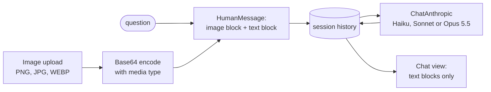

# Multimodal Image Q&A with Claude

**Upload an image and ask about it: charts, screenshots, photos, documents. A Streamlit chat app that sends the image and your question to Claude's vision model and keeps the conversation going.**

**[Live demo →](https://multimodal-claude-chatbot.streamlit.app/)** (bring your own Anthropic API key; the app may take a few seconds to wake up)

[](https://github.com/dojedaro/multimodal-claude-chatbot/actions/workflows/notebooks.yml)


## Examples

| | |
|---|---|
|  |  |

## How it works



- The image and question travel as one multimodal message (an image content block plus a text block),
  so follow-up questions keep the image in context.
- Conversation history lives in `st.session_state`, so the whole chat is sent on each turn.
- Current Claude models can return thinking blocks before the answer; the chat view renders only the
  text blocks.

## Run it

```bash
pip install -r requirements.txt
cp .env.example .env          # add ANTHROPIC_API_KEY
streamlit run app/app.py
```

`End_to_end_App_Anthropic.ipynb` is the notebook the app was developed in.

## Stack

Python, Streamlit, LangChain (Anthropic integration), Claude vision, Pillow, python-dotenv.

## Limitations and next steps

- Each turn resends the image. Prompt caching on the image block would cut cost and latency for
  long conversations.
- No evaluation of answer quality; a small labeled set (chart values, text in screenshots) would
  measure it per model.
- Large images are sent as-is; resizing to the model's useful resolution first would save tokens.

## License

MIT
